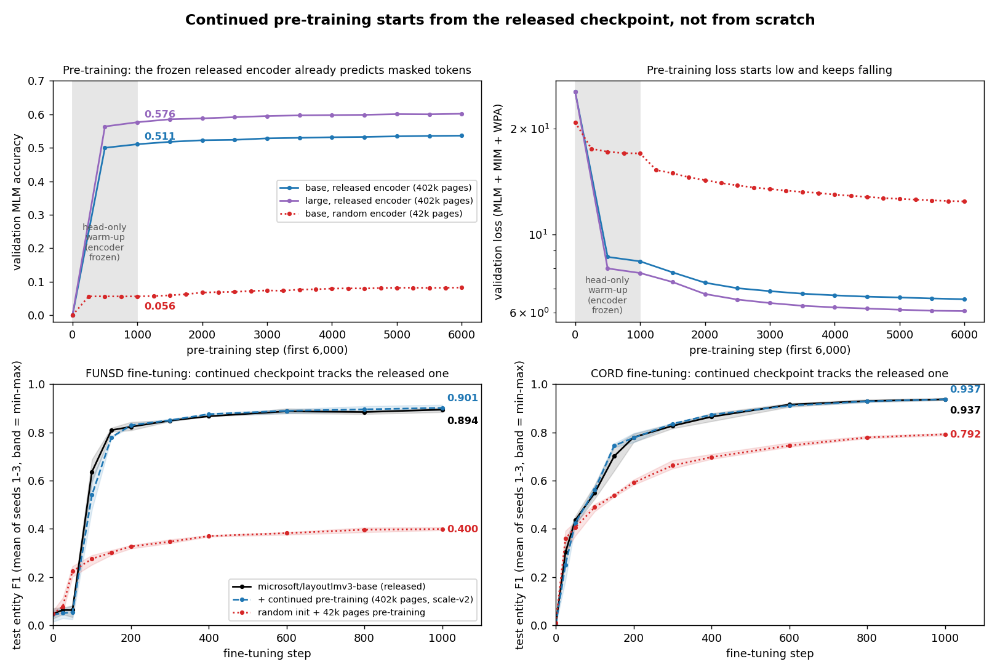
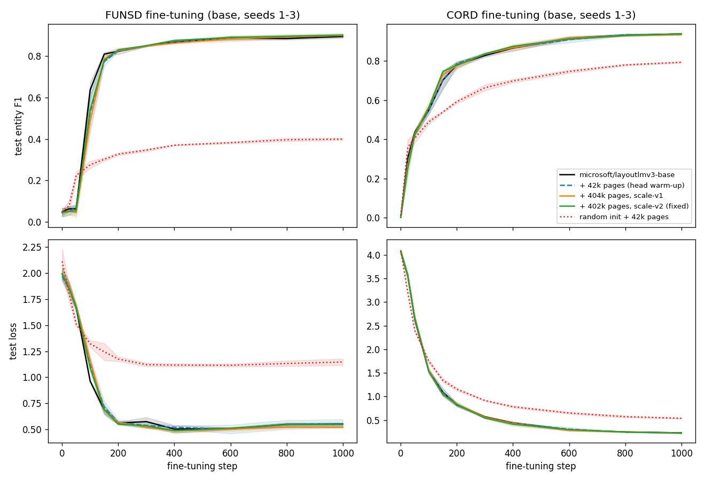
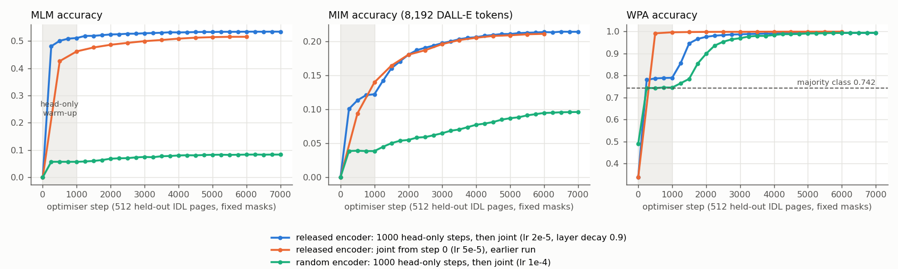
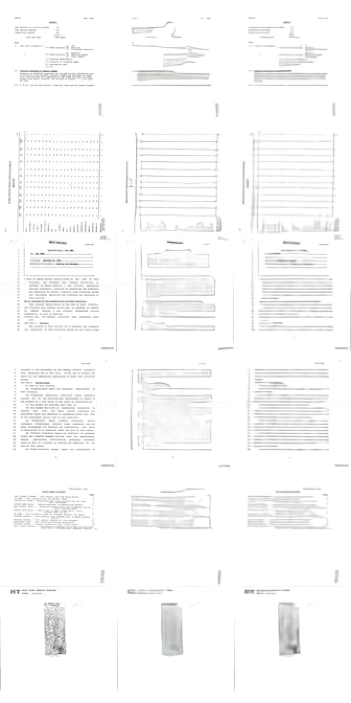

# LayoutLMv3 pre-training objectives (MLM, MIM, WPA) for Hugging Face transformers

[LayoutLMv3](https://arxiv.org/abs/2204.08387) is pre-trained with three objectives: masked language modelling (MLM), masked image modelling (MIM) and word-patch alignment (WPA). The official release includes fine-tuning code but not the pre-training code, and people keep asking for it (see [microsoft/unilm#733](https://github.com/microsoft/unilm/issues/733), [#1042](https://github.com/microsoft/unilm/issues/1042), [#1609](https://github.com/microsoft/unilm/issues/1609), [#772](https://github.com/microsoft/unilm/issues/772) and [#785](https://github.com/microsoft/unilm/issues/785)).

This repository is a small, tested implementation of the three objectives on top of `transformers`' `LayoutLMv3Model`. You can use it for continued pre-training of `microsoft/layoutlmv3-base` or `-large` on your own documents, or as a reference for how the objectives fit together.

It is an independent re-implementation from the paper, not Microsoft's original code.

A write-up of what continued pre-training did and did not change: [blog post](https://14h034160212.github.io/blog/layoutlmv3-continued-pretraining.html) ([中文](https://14h034160212.github.io/blog/layoutlmv3-continued-pretraining-zh.html)).

## Key check: continued pre-training starts from the released checkpoint



- **Pre-training (top row):** the released checkpoints contain no pre-training heads. Step 0 is the point after a 1,000-step head-only warm-up: the encoder has not changed, but the new heads have learned to read it. From there, the released encoder starts at **0.511 (base) / 0.576 (large)** masked-token accuracy and loss 8.4 / 7.8. A randomly initialised encoder starts at **0.056** and loss 17.0. Before the warm-up, the random heads make every encoder score about 0, so that point says nothing about the encoder.
- **Fine-tuning (bottom row):** the continued checkpoint follows the released checkpoint's curve from the first step. Final F1 is FUNSD 0.901 vs 0.894 and CORD 0.937 vs 0.937. From scratch: 0.400 and 0.792. At fine-tuning step 0 every model has a new random classifier, so all start near 0 F1; what matters is that the continued and released curves overlap.

The numbers behind the figure are in [Starting points at a glance](#starting-points-at-a-glance). The figure is drawn by `scripts/plot_starting_points.py`.

## What is implemented

| Objective | Paper | Here |
|---|---|---|
| **MLM** | Mask 30% of text tokens with span masking, span lengths ~ Poisson(λ=3) | `masking.span_mask`, plus an `LMHead` tied to the word embeddings |
| **MIM** | Mask 40% of image patches with blockwise masking; predict discrete visual tokens from an image tokenizer | `masking.blockwise_mask`; masked patch embeddings are replaced by a learned `[MASK]` embedding before position embeddings are added; a linear head predicts the tokens |
| **WPA** | For each *unmasked* text token, predict whether its image patches are also unmasked (aligned) or not (unaligned) | `masking.wpa_labels`, which maps each token's 0-1000 box to the 14×14 patch grid, plus a two-layer MLP head on the text token (the paper: "a two-layer MLP head"; see [WPA](#evidence-per-objective-frozen-encoder-probes)) |

The total loss is `MLM + MIM + WPA`, and all three terms back-propagate into the shared encoder. `tests/test_pretraining.py` checks this explicitly, because it is an easy thing to break: for example, adding a loss with `.item()` silently removes it from the gradient.

The output `backbone/` is a plain `LayoutLMv3Model` checkpoint, so `LayoutLMv3ForTokenClassification.from_pretrained(...)` and the other task heads load it directly.

### One deliberate difference: the MIM targets

The paper's MIM targets come from a dVAE image tokenizer trained on documents (from DiT), whose weights are not part of the LayoutLMv3 release. This repository offers two substitutes instead:

- **`DalleTokenizer`** (`--image_tokenizer dalle`): OpenAI's public DALL-E dVAE encoder ([openai/DALL-E](https://github.com/openai/DALL-E), modified MIT licence; weights from `https://cdn.openai.com/dall-e/encoder.pkl`), 8,192 visual tokens. This is the tokenizer BEiT v1 used. As in BEiT, it sees a 112×112 view of the 224×224 image, and its 8× down-sampling gives a 14×14 token grid, one token per LayoutLMv3 16×16 patch. The LayoutLMv3 processor's normalisation (mean = std = 0.5) is undone and dall_e's `map_pixels` is applied before encoding. `dvae.py` re-implements the encoder with the same parameter names and loads `encoder.pkl` through a restricted unpickler, so the `dall_e` package is not needed. A check against the original `dall_e` package gave identical logits. **This dVAE was trained on natural images, not documents**, so it is still not the paper's tokenizer.
- **`KMeansPatchTokenizer`** (`--image_tokenizer kmeans`, the default): a k-means codebook (512 entries) over down-sampled grey-scale 16×16 patches, fitted on your own training images. It needs no external weights but is much cruder than a dVAE.

Any object with `vocab_size` and `encode(pixel_values) -> LongTensor[B, 196]` can be plugged in instead.

### Optimiser

AdamW with betas (0.9, 0.98) as in the paper, weight decay 0.01, layer-wise learning-rate decay (BEiT-style). As in BEiT, biases, LayerNorm weights, the visual `[CLS]` token and position embedding (`cls_token`, `pos_embed`), the image `[MASK]` token, the text, 1D and 2D position embeddings and the relative position biases get no weight decay (`LayoutLMv3ForPreTraining.no_weight_decay`). Runs before scale-v2 used PyTorch's default betas (0.9, 0.999) and weight decay on every parameter. Fine-tuning (`scripts/finetune_funsd.py`) is unchanged.

### Known limitations

These differences from the paper or quirks are known and left as they are:

- **Span masking works on sub-word tokens**, not whole words: a span can start or end inside a word. The paper does not say which unit it uses.
- **FUNSD fine-tuning labels a few non-first sub-tokens.** The tokenizer splits the check-box characters ☐/☑ into two byte-level tokens and the processor labels both, so 123 of 21,958 labelled tokens in FUNSD train (57 of 8,413 in test) are second sub-tokens. All checkpoints are fine-tuned and scored the same way, so comparisons are not affected, but absolute F1 differs slightly from a first-sub-token-only evaluation.
- **The relative position bias tables are not trained (transformers ≥ 4.42).** `transformers`' LayoutLMv3 looks up the 1D and 2D relative position biases inside `torch.no_grad()` (added in transformers#30988), so `rel_pos_bias`, `rel_pos_x_bias` and `rel_pos_y_bias` get no gradient and keep their released values in every pre-training and fine-tuning run here. Reported as [transformers#50636](https://github.com/huggingface/transformers/issues/50636).
- **The FUNSD-test filter has limited recall.** It compares word 5-grams in OCR order. FUNSD test pages in annotation order are all caught, but in reading order only 62% are, and 46% with 5% word-level OCR errors. A near-duplicate page with different OCR order can get through.

## Quick start

```bash
pip install -e ".[dev]"
pytest tests                    # 35 tests, CPU, ~10 seconds (one is skipped without the DALL-E weights)

# continued pre-training on FUNSD train (words and boxes from the dataset, no OCR), k-means MIM targets
python scripts/pretrain.py --output_dir runs/funsd_pt --max_steps 3000

# continued pre-training on ~42k Industry Documents Library pages, DALL-E dVAE MIM targets
python scripts/pretrain.py --corpus idl --idl_shards 0-26 --exclude_funsd_test --image_tokenizer dalle \
    --output_dir runs/idl_dalle_base --max_steps 6000 --batch_size 16 --grad_accum 2 --num_workers 12 \
    --eval_every 500 --patience 4 --val_docs 512

# downstream checks: FUNSD and CORD entity labelling, 5 seeds
python scripts/finetune_funsd.py --task funsd --model microsoft/layoutlmv3-base --seeds 1 2 3 4 5
python scripts/finetune_funsd.py --task cord  --model runs/idl_dalle_base/backbone --seeds 1 2 3 4 5
```

`scripts/run_experiment.sh` runs the FUNSD-only experiment and `scripts/run_idl_experiment.sh` the IDL one (`SIZE=base` or `SIZE=large`).

### Training options

| Flag | What it does |
|---|---|
| `--corpus hf` / `--corpus idl` | a small Hugging Face dataset with words and 0-1000 boxes (default FUNSD train), or IDL pages streamed shard by shard |
| `--idl_shards 0-26`, `--pages_per_doc 2`, `--max_pages N` | which `pixparse/idl-wds` shards make up the corpus, and how many pages to take |
| `--idl_stream` | read the shards over HTTP (`HfFileSystem`) instead of caching them locally first |
| `--exclude_funsd_test` | drop IDL pages whose word 5-grams mostly (≥50%) occur in the FUNSD test documents |
| `--image_tokenizer dalle\|kmeans`, `--dalle_encoder PATH` | MIM targets (the DALL-E encoder is downloaded if no path is given) |
| `--gradient_checkpointing` | trade compute for memory |
| `--grad_accum N` | effective batch size = `batch_size × N` |
| `--num_workers N` | DataLoader worker processes (IDL decoding and masking run there; MIM targets are computed on the GPU) |
| `--eval_every`, `--patience` | validation on fixed held-out pages with fixed masks; `backbone/` always holds the step with the lowest validation loss, and training stops after `patience` evaluations without improvement |
| `--save_last` | also keep the final step in `last_backbone/` |
| `--head_warmup_steps N`, `--head_lr` | first train only the parameters the released checkpoints lack (the three heads and the image `[MASK]` embedding) for `N` steps with the encoder frozen, then train jointly; see [Head warm-up](#head-warm-up-the-released-encoder-starts-from-a-good-point) |
| `--layer_decay d`, `--new_params_lr` | layer-wise learning-rate decay (BEiT-style: layer *i* of *L* gets `lr * d^(L-i)`, embeddings `lr * d^(L+1)`), and the heads' lr after the warm-up (default `--lr`) |
| `--wpa_head mlp\|linear\|mlp_patch` | WPA classifier: two-layer MLP on the text token (default, as the paper describes) or a single linear layer (the default until the [scale-up](#scaling-the-continued-pre-training-data); every earlier result below used it); `mlp_patch` (MLP on [text token; mean of its covered patches]) leaks the label through the `[MASK]` patch embedding and is only for reproducing that probe |
| `--state_every N`, `--resume` | save model, optimiser and scheduler state every `N` steps and continue from it after an interruption. With `--corpus idl` the page stream continues where it stopped: the workers skip the pages of the batches already used, so nothing is replayed (needs the same `--batch_size`, `--grad_accum` and `--num_workers`; checked on resume); masks after a resume come from a new random stream. Before scale-v2 the stream restarted from the first shards with a new seed |
| `--idl_orientation fix\|drop\|off` | IDL frames stored turned relative to their OCR boxes (about 10% of pages): `fix` (default) turns 90/270-degree pages upright and drops 180-degree and ambiguous ones, `drop` drops all of them, `off` uses the frames as stored (every run before scale-v2) |
| `--random_init` | control: the checkpoint's config with random weights |
| `--tags ...` | tags for the run registry (see [Run registry](#run-registry)) |

### The IDL corpus

`--corpus idl` reads [`pixparse/idl-wds`](https://huggingface.co/datasets/pixparse/idl-wds), a webdataset version of the [UCSF Industry Documents Library](https://www.industrydocuments.ucsf.edu/) (about 19M pages with Textract OCR). Each sample is a document: a multi-page TIFF plus OCR JSON with text **lines** and their boxes (`[left, top, width, height]`, relative to the page). `corpus.py` splits each line into words and gives each word its line's box, scaled to 0-1000. This is a segment-level layout, which is what LayoutLMv3 uses in pre-training (and what `nielsr/funsd-layoutlmv3` provides). Lines with OCR confidence < 0.5 and pages with < 10 words are skipped, and at most 512 words are kept per page. Shards are split across DataLoader workers and a shuffle buffer randomises the order, so the corpus is never materialised. Each DataLoader worker draws its own masks (seeded with the run seed and the worker id).

**Page orientation.** About 10% of the TIFF frames are stored turned by 90 or 270 degrees (and about 1% by 180 degrees) relative to the frame their OCR boxes are in, so horizontal boxes lie across vertical text. Every run before scale-v2 trained on such pages as stored. `corpus.page_orientation` compares the page with its boxes on a 256 × 256 grid: for each of the four quarter turns it measures how much of the page's edge energy falls inside the boxes, relative to the area they cover. A turn is applied only if it beats the stored frame by a factor of 1.3; 90/270-degree pages are then turned upright, and 180-degree pages and ambiguous ones (a turn wins by less than 1.3) are dropped, because for those it cannot tell cheaply whether the image or the boxes are upside down. On 200 documents each of shards 0 and 2999 it turned 26 of 286 and 33 of 299 pages and dropped 4 and 4. All 63 pages it flagged in a hand check were really turned, and none of 40 random unflagged pages were. It costs about 5% of DataLoader throughput (392 → 371 pages/s with 12 CPU workers, far above what training uses).

FUNSD itself comes from RVL-CDIP, which was drawn from the same tobacco-industry archive, so IDL is in-domain for FUNSD and could contain FUNSD test pages. `--exclude_funsd_test` removes near-duplicates by word 5-gram overlap. In the run below it removed 1 page. This check only catches pages with similar OCR text, and `microsoft/layoutlmv3-*` was itself pre-trained on IIT-CDIP, which is from the same archive.

**Terms.** The dataset card gives no open licence (`license: other`). It says the documents remain under their rights holders' copyright and that IDL makes them available under court-approved agreements or under US fair use, which, as the card notes, may permit use "for purposes such as ... scholarship or research". Each user is responsible for staying within fair use. Here the pages are used only to compute research model updates; no page images or text are redistributed in this repository. Check the [dataset card](https://huggingface.co/datasets/pixparse/idl-wds) and your own situation before using it, especially for anything commercial. (`pixparse/pdfa-eng-wds` was the alternative; its card points to the Common Crawl and Digital Corpora terms, but its PDF-extracted text is less like FUNSD's scanned forms.)

## Results

These are small-scale experiments, not a reproduction of the paper: the corpus is 42k-400k pages rather than 11M, the MIM targets come from a natural-image dVAE rather than the paper's document dVAE, and the training budget is a few GPU hours per run.

**WPA head.** Every run in the sections below up to and including the recipe screen and the large warm-up run used a **linear** WPA head, which was the default then (the screen's variant B and the `mlp` probes are the exceptions). The default is now the paper's two-layer MLP on the text token (`--wpa_head mlp`). The screen found the two heads equivalent downstream: B (MLP) minus A (linear) was −0.26 F1 points, within the 0.6-point noise threshold. Each run's head is recorded in the run registry (`wpa=` column of `scripts/list_runs.py`). The run scripts now default to `WPA=mlp`, so pass `WPA=linear` to reproduce the earlier runs exactly.

### Starting points at a glance

Is continued pre-training really building on the released checkpoints rather than starting from scratch? The quickest check is the starting points, both of pre-training and of fine-tuning afterwards. The sections below give the details.

**1. Pre-training starting point** (validation: 512 held-out IDL pages, fixed masks). Step 0 measures the randomly initialised pre-training heads, which the released checkpoints don't include. After 1,000 head-only steps with the encoder frozen and unchanged, the numbers measure what the released encoder already knows.

| run | loss, step 0 | after head warm-up: loss / MLM acc / MIM acc | best joint step: loss / MLM acc / MIM acc |
|---|---:|---:|---:|
| base, released encoder, 42k pages | 24.78 | 8.57 / **0.511** / 0.122 | 6.77 / 0.534 / 0.214 |
| base, released encoder, 402k pages (scale-v2) | 25.42 | 8.38 / **0.511** / 0.123 | 6.21 / 0.549 / 0.260 |
| large, released encoder, 42k pages | 24.94 | 8.00 / **0.574** / 0.129 | 6.41 / 0.596 / 0.209 |
| large, released encoder, 402k pages (scale-v2) | 25.43 | 7.77 / **0.576** / 0.138 | 5.70 / 0.613 / 0.269 |
| base, **random** encoder, same 42k recipe | 20.83 | 16.99 / 0.056 / 0.039 | 12.37 / 0.083 / 0.096 |

**2. Fine-tuning starting point** (base, seeds 1-3, mean test entity F1 / test loss during fine-tuning, `results/curves_v1/`). At step 0 the token classifier is new and random for every model, so all start at the same test loss.

FUNSD:

| initialisation | step 0 | step 50 | step 100 | step 150 | step 200 | step 400 | step 1000 |
|---|---:|---:|---:|---:|---:|---:|---:|
| `microsoft/layoutlmv3-base` | 0.05 / 1.99 | 0.06 / 1.67 | 0.64 / 0.96 | 0.81 / 0.69 | 0.82 / 0.56 | 0.87 / 0.50 | 0.89 / 0.55 |
| + 42k pages (head warm-up) | 0.05 / 1.97 | 0.07 / 1.66 | 0.53 / 1.13 | 0.77 / 0.71 | 0.82 / 0.57 | 0.87 / 0.52 | 0.90 / 0.55 |
| + 404k pages, scale-v1 | 0.05 / 1.99 | 0.05 / 1.69 | 0.49 / 1.16 | 0.79 / 0.68 | 0.83 / 0.56 | 0.86 / 0.49 | 0.90 / 0.52 |
| + 402k pages, scale-v2 (fixed) | 0.05 / 1.99 | 0.05 / 1.67 | 0.54 / 1.09 | 0.78 / 0.69 | 0.83 / 0.55 | 0.88 / 0.49 | 0.90 / 0.55 |
| random init + 42k pages | 0.05 / 2.11 | 0.22 / 1.51 | 0.28 / 1.32 | 0.30 / 1.24 | 0.33 / 1.17 | 0.37 / 1.12 | 0.40 / 1.15 |

CORD:

| initialisation | step 0 | step 50 | step 100 | step 150 | step 200 | step 400 | step 1000 |
|---|---:|---:|---:|---:|---:|---:|---:|
| `microsoft/layoutlmv3-base` | 0.00 / 4.07 | 0.44 / 2.63 | 0.55 / 1.54 | 0.70 / 1.09 | 0.78 / 0.82 | 0.86 / 0.44 | 0.94 / 0.23 |
| + 42k pages (head warm-up) | 0.00 / 4.08 | 0.43 / 2.66 | 0.55 / 1.53 | 0.70 / 1.08 | 0.79 / 0.82 | 0.87 / 0.43 | 0.93 / 0.23 |
| + 404k pages, scale-v1 | 0.00 / 4.07 | 0.43 / 2.67 | 0.56 / 1.55 | 0.73 / 1.04 | 0.77 / 0.84 | 0.87 / 0.43 | 0.93 / 0.22 |
| + 402k pages, scale-v2 (fixed) | 0.00 / 4.07 | 0.42 / 2.66 | 0.56 / 1.53 | 0.74 / 1.05 | 0.78 / 0.83 | 0.87 / 0.41 | 0.94 / 0.22 |
| random init + 42k pages | 0.01 / 4.09 | 0.41 / 2.40 | 0.49 / 1.75 | 0.54 / 1.34 | 0.59 / 1.15 | 0.70 / 0.78 | 0.79 / 0.54 |

**Reading:**
- **Pre-training.** The frozen released encoder gives a fresh MLM head 0.51 (base) and 0.58 (large) accuracy within 1,000 steps, against 0.06 for a random encoder. Pre-training then improves from there.
- **Fine-tuning.** Every continued checkpoint follows the released checkpoint's fine-tuning curve on both tasks from the first steps, reaching F1 above 0.8 on FUNSD by step 150-200. The only visible difference is a short lag at FUNSD step 100. The randomly initialised model plateaus far lower, at 0.40 on FUNSD and 0.79 on CORD.



### Continued pre-training on 42k IDL pages with dVAE targets

**Setup.** IDL shards 0-26 (`pixparse/idl-wds`), at most 2 pages per document, giving **42,061 training pages** (1 page removed by the FUNSD-test filter). 512 pages from shard 2999 are held out, with fixed masks, to pick the checkpoint. MIM targets: DALL-E dVAE, 8,192 tokens. bf16 autocast, AdamW (weight decay 0.01), cosine schedule with 5% warm-up, gradient clipping 1.0, 12 DataLoader workers, one A100 80GB per model.

| | base | large |
|---|---|---|
| start | `microsoft/layoutlmv3-base` (768 × 12 layers) | `microsoft/layoutlmv3-large` (1024 × 24 layers) |
| optimiser steps | 6,000 | 4,000 |
| batch | 16 × 2 accumulation = 32 pages | 16 × 2 accumulation = 32 pages |
| pages seen | 192k (≈4.6 passes) | 128k (≈3.0 passes) |
| peak learning rate | 5e-5 | 3e-5 |
| gradient checkpointing | off (fits) | off (58 GB peak); in a 60-step test, turning it on gave identical losses and was ~30% slower |
| training time | 90 min | 184 min |
| best validation step | 6,000 (last) | 4,000 (last) |

Training times are wall-clock on GPUs that were partly shared with the fine-tuning runs. The whole experiment (both pre-training runs, 40 fine-tuning runs and short smoke tests) took about 6.3 GPU-hours. The large model got fewer steps to keep the total GPU time reasonable. For both models, validation loss was still going down slowly at the last step, so with 42k pages neither run reached the over-fitting seen with 129 FUNSD documents.

**The objectives learn** (512 held-out IDL pages, fixed masks):

| | base: start → end | large: start → end | Majority-class baseline |
|---|---:|---:|---:|
| MLM accuracy | 0.00 → 0.515 | 0.00 → 0.559 | n/a |
| MIM accuracy (8,192 dVAE tokens) | 0.00 → 0.211 | 0.00 → 0.199 | 0.038¹ |
| WPA accuracy | 0.34 → 0.999 | 0.54 → 0.997 | 0.742 |

¹ Most frequent DALL-E code on the masked validation patches (fixed masks). An earlier version of this table said 0.027; that number could not be traced back to how it was computed, so it was re-measured.

WPA is close to trivial in this implementation: whether a token's patches are masked can be read off the learned `[MASK]` patch embeddings, so do not read much into its accuracy.

**Downstream entity F1** (mean ± sample std over seeds 1-5; the same seeds and data order for every initialisation). FUNSD: 1,000 steps, lr 1e-5, batch size 2. CORD v2: 1,000 steps, batch size 4, lr 5e-5 (base) or 2e-5 (large). The CORD recipe is short; it was not tuned to reach the paper's numbers.

| Initialisation | FUNSD F1 | CORD F1 |
|---|---:|---:|
| `microsoft/layoutlmv3-base` | 0.895 ± 0.007 | 0.936 ± 0.004 |
| + continued pre-training on IDL (this repo) | 0.900 ± 0.007 | 0.937 ± 0.005 |
| `microsoft/layoutlmv3-large` | 0.903 ± 0.006 | 0.956 ± 0.005 |
| + continued pre-training on IDL (this repo) | 0.905 ± 0.005 | 0.952 ± 0.003 |

Per-seed differences (continued minus original), paired by seed: base FUNSD +1.45, +1.42, −0.59, +0.59, −0.31 F1 points (mean +0.51, paired t-test p = 0.29), base CORD +0.34, −0.94, +0.82, +0.68, −0.21 (mean +0.14, p = 0.69); large FUNSD +0.13, +0.90, −0.04, −0.51, +0.74 (mean +0.24, p = 0.40), large CORD +0.31, −0.49, −1.51, +0.01, −0.67 (mean −0.47, p = 0.21). None of the four differences can be told apart from seed noise with 5 seeds, and the large model on CORD is, if anything, slightly worse. So continued pre-training on 42k IDL pages with dVAE targets gave **no reliable gain** over the released checkpoints at this scale. This is not surprising: the released models were already pre-trained on 11M pages from the same kind of documents, and this run adds under 0.5% as many pages for a few thousand steps.

Per-seed scores and the pre-training logs are in `results/idl/`.

### Head warm-up: the released encoder starts from a good point

**The problem with the run above.** The released `microsoft/layoutlmv3-{base,large}` checkpoints contain only the encoder (212 `layoutlmv3.*` tensors for base). The MLM head's dense + LayerNorm, the MIM head, the WPA head and the image `[MASK]` embedding are therefore random at step 0 (only the MLM decoder weight is meaningful, because it is tied to the word embeddings). The step-0 validation numbers above (loss 24.8, MLM accuracy 0.00) measure these random heads, not the encoder, and the encoder was then trained jointly with them from step 0 at lr 5e-5 (base) / 3e-5 (large). Random-head gradients could have damaged the pretrained encoder, and the curve looked like training from zero.

**What was changed** (`--head_warmup_steps`, `--head_lr`, `--layer_decay`; `scripts/run_idl_warmup_experiment.sh`):

1. *Loading check.* `from_backbone` now asserts and logs that `LayoutLMv3Model.from_pretrained` reports no missing, unexpected or mismatched keys (true for base: 212 tensors loaded, the only encoder parameter not in the checkpoint is our image `[MASK]` embedding).
2. *Head warm-up.* 1,000 steps that train only the new parameters (the three heads, the MLM decoder bias, the image `[MASK]` embedding; AdamW, lr 1e-3, cosine with 10% warm-up) with every checkpoint parameter frozen, including the word embeddings and hence the tied MLM decoder weight. The validation loss at the end of the warm-up is the starting point of the released encoder.
3. *Gentler joint training.* Then 6,000 joint steps (same corpus, batch, schedule shape and step count as the run above) at a peak lr of 2e-5 for the top layer with layer-wise decay 0.9 (BEiT-style; the embeddings get 2e-5 × 0.9¹³ ≈ 5e-6) and 2e-5 for the heads. The aim is to adapt the encoder to the new objectives without moving the lower layers much.
4. *Control.* The same config with random weights (`--random_init`): the same 1,000 head-only steps, then 6,000 joint steps at lr 1e-4 without layer decay (a from-scratch run needs a higher lr than continued training).

**Validation metrics** (512 held-out IDL pages, fixed masks; base):

| | step 0 | after 1,000 head-only steps (encoder frozen) | end of joint training |
|---|---|---|---|
| **released encoder**: loss | 24.78 | 8.57 | **6.77** (step 7,000) |
| MLM loss / accuracy | 14.78 / 0.000 | **2.79 / 0.511** | 2.61 / 0.534 |
| MIM loss / accuracy | 9.19 / 0.000 | 5.33 / 0.122 | 4.14 / 0.214 |
| WPA balanced accuracy / AUC | 0.497 / 0.513 | 0.664 / 0.816 | 0.992 / 1.000 |
| **random encoder** (same config): loss | 20.83 | 16.99 | 12.37 (step 6,750) |
| MLM loss / accuracy | 10.93 / 0.000 | 9.13 / 0.056 | 6.55 / 0.083 |
| MIM loss / accuracy | 9.17 / 0.000 | 7.31 / 0.039 | 5.80 / 0.096 |
| WPA balanced accuracy / AUC | 0.491 / 0.488 | 0.512 / 0.650 | 0.992 / 1.000 |
| *earlier run (joint from step 0, lr 5e-5)*: loss | 24.78 | | 6.95 (step 6,000) |
| MLM / MIM accuracy; WPA balanced accuracy / AUC | 0 / 0; 0.497 / 0.513 | | 0.515 / 0.211; 0.999 / 1.000 |



*WPA balanced accuracy and AUC were not logged during these runs; the step-0 values come from the probe runs below (identical step 0), the others from re-evaluating the saved checkpoints with the same pages and masks (`scripts/eval_pretraining_checkpoint.py`, `results/idl_warmup/reeval/`; the re-evaluation reproduces every logged loss exactly). Chance is 0.5 for both. In the plot, steps are optimiser steps; the warm-up runs take 1,000 more of them (and see 32k more pages) than the earlier run, and WPA is shown as raw accuracy against the majority rate 0.742 ("aligned"). For MIM, the most frequent dVAE token is 3.8% of masked patches.*

**What the warm-up shows, read as a correctness check of this re-implementation.** With the encoder frozen, a freshly initialised head reaches MLM accuracy 0.511 (loss 24.8 → 8.57 overall) in 1,000 steps, against 0.056 for the same head on a random encoder (which is about what predicting frequent tokens gives). A fresh head can only read masked tokens out of the encoder that well if (a) the checkpoint is loaded correctly and (b) the MLM input pipeline here (tokenisation, segment-level 2D layout with 0-1000 boxes, span masking with `<mask>`, the image input) is close to what the encoder saw in pre-training; with mismatched positions, boxes or image normalisation the frozen features would not be readable like this. It does **not** show that this code is equivalent to Microsoft's pre-training code, and it says little about the other two objectives:

- **MIM** is not comparable to the paper: the targets here are tokens of OpenAI's natural-image DALL-E dVAE, not the paper's document dVAE, so the released encoder was never trained to predict them. The frozen encoder still gives 0.122 accuracy versus 0.039 for the random encoder (≈ the 3.8% majority rate), so its patch features carry usable visual information, but the number is a property of our targets.
- **WPA** after the warm-up: balanced accuracy 0.664 and AUC 0.816 with the frozen released encoder, against 0.512 / 0.650 for the random encoder (chance 0.5 / 0.5). In raw accuracy that is only 0.789 against a majority rate of 0.742 (random: 0.745). So a linear head on the text token does read alignment information from the frozen encoder, clearly above chance by AUC, but weakly. That shows the signal is there, not that our WPA formulation matches the paper's (see the probes below). After joint training WPA reaches balanced accuracy 0.99 and AUC 1.00 for both encoders, the random one included, so WPA is close to trivial here once the encoder can learn to detect the `[MASK]` patch embedding.

Notably, the earlier run's *final* MLM accuracy (0.515 after 6,000 joint steps) is barely above what the frozen released encoder gives after the 1,000-step head warm-up (0.511). Most of what the earlier MLM curve showed was the head being learned, not the encoder improving.

**Sanity check: the warm-up leaves the encoder unchanged.** The maximum absolute change of every checkpoint parameter over the warm-up is 0.0 (logged), the saved `warmup_backbone/` is bit-identical to `microsoft/layoutlmv3-base` (212 tensors, `scripts/compare_results.py --same_encoder`), and fine-tuning it on FUNSD (seed 1) gives exactly the original's 0.8838.

**Downstream** (same fine-tuning recipes and seeds 1-5 as above; paired t-test against the original checkpoint):

| Initialisation (base) | FUNSD F1 | CORD F1 |
|---|---:|---:|
| `microsoft/layoutlmv3-base` | 0.895 ± 0.007 | 0.936 ± 0.004 |
| + continued pre-training, joint from step 0 (above) | 0.900 ± 0.007 (p = 0.29) | 0.937 ± 0.005 (p = 0.69) |
| + continued pre-training, head warm-up + gentler joint training | 0.899 ± 0.004 (p = 0.19) | 0.933 ± 0.004 (p = 0.27) |
| random init + the same 7,000 steps (2 seeds) | 0.402 ± 0.007 | not run |

Per-seed differences (warm-up recipe minus original): FUNSD +1.39, −0.12, +0.48, 0.00, +0.35 F1 points (mean +0.42); CORD +0.23, −1.07, −0.41, +0.22, −0.54 (mean −0.31). Neither difference can be told apart from seed noise, and against the earlier continued checkpoint the warm-up recipe is −0.09 on FUNSD (p = 0.85) and −0.45 on CORD (p = 0.09). So the head warm-up fixes the starting point and ends at a lower validation loss (6.77 vs 6.95; MLM accuracy 0.534 vs 0.515, MIM 0.214 vs 0.211), but it still gives **no reliable downstream gain** at this scale. Damage from random-head gradients does not explain the earlier null result; the more likely reason remains the one given above (a few thousand steps on 42k pages, on top of 11M pages of pre-training on similar documents).

The from-scratch control shows how far ahead continued pre-training starts: with the same 7,000 steps on 42k pages, a randomly initialised model reaches FUNSD F1 0.40, against 0.895 for the released checkpoint before any continued training.

**Large.** The recipe screen below found no clearly better variant, so `layoutlmv3-large` was rerun with the same recipe (`GPU=3 SIZE=large INIT=pretrained ./scripts/run_idl_warmup_experiment.sh`): 1,000 head-only steps, then 4,000 joint steps at lr 1e-5. Layer decay is 0.95 instead of base's 0.9. Over 24 layers that keeps the embeddings' lr at about the same fraction of the top layer's lr as base gets (0.95²⁵ ≈ 0.28 against 0.9¹³ ≈ 0.25), whereas 0.9 would give 0.07.

| `layoutlmv3-large`, 512 held-out pages | loss | MLM acc | MIM acc | WPA AUC |
|---|---:|---:|---:|---:|
| step 0 (random heads) | 24.94 | 0.000 | 0.000 | 0.47 |
| after the 1,000-step head warm-up (encoder frozen, unchanged) | 8.00 | **0.574** | 0.129 | 0.79 |
| best, step 4,500 | 6.41 | 0.596 | 0.209 | 0.999 |
| earlier run, joint from step 0: best, step 4,000 | 6.88 | 0.559 | 0.199 | n/a |

As for base, the frozen released large encoder gives a fresh MLM head 0.574 accuracy within 1,000 steps, against 0.511 for base. Joint training then changes the encoder by 0.66% on average (relative parameter change, `results/idl_warmup/drift_large_pretrained.json`).

| Initialisation (large) | FUNSD F1 | CORD F1 |
|---|---:|---:|
| `microsoft/layoutlmv3-large` | 0.903 ± 0.006 | 0.956 ± 0.005 |
| + continued pre-training, joint from step 0 (above) | 0.905 ± 0.005 (p = 0.40) | 0.952 ± 0.003 (p = 0.21) |
| + continued pre-training, head warm-up + gentler joint training | 0.901 ± 0.005 (p = 0.67) | 0.954 ± 0.004 (p = 0.33) |

The table shows mean ± sample std over seeds 1-5, with paired t-tests against the original checkpoint (CORD fine-tuned at lr 2e-5).

Per-seed differences (warm-up recipe minus original):

| Task | Seed 1 | Seed 2 | Seed 3 | Seed 4 | Seed 5 | Mean |
|---|---:|---:|---:|---:|---:|---:|
| FUNSD | +0.22 | −0.63 | −0.02 | −0.84 | +0.65 | −0.12 |
| CORD | −0.11 | +0.49 | −0.91 | −0.33 | −0.41 | −0.25 |

Against the earlier large checkpoint, the warm-up recipe is −0.37 on FUNSD (p = 0.29) and +0.22 on CORD (p = 0.47). The picture is the same as for base. The warm-up gives a high starting point and a lower final validation loss, but no difference from the released checkpoint downstream that can be told apart from seed noise.

Per-run logs, per-seed scores and the registry entries are in `results/idl_warmup/` and `experiments/registry.jsonl`.

### Evidence per objective: frozen-encoder probes

To see how much of each objective the released encoder already supports, and whether our choices for WPA and MIM are what limits it, each variant below was run as a **probe**: the released (or a randomly initialised) `layoutlmv3-base` encoder frozen, 1,000 head-only steps (`--head_warmup_steps 1000 --max_steps 0`, lr 1e-3), metrics on the same 512 held-out IDL pages with fixed masks (`scripts/run_probes.sh`, `scripts/summarize_probes.py`, `results/probes/`). A probe measures how readable a target is from frozen features; it is not a pre-training result.

| Objective | Variant | released encoder | random encoder | baseline |
|---|---|---:|---:|---:|
| MLM | accuracy | **0.511** | 0.056 | n/a |
| MIM | DALL-E dVAE targets (8,192), accuracy | **0.122** | 0.039 | 0.038 (majority) |
| MIM | DALL-E dVAE fine-tuned on IDL pages, accuracy | **0.121** | 0.024 | 0.024 (majority) |
| MIM | k-means codebook (512), accuracy | **0.502** | 0.297 | 0.297 |
| WPA | linear head on the text token: balanced accuracy / AUC | 0.664 / 0.816 | 0.512 / 0.650 | 0.5 / 0.5 |
| WPA | 2-layer MLP on the text token: balanced accuracy / AUC | **0.771 / 0.904** | 0.546 / 0.686 | 0.5 / 0.5 |
| WPA | *leaky probe*: 2-layer MLP on [text token; mean of its covered patches] | 0.985 / 0.999 | 0.9997 / 1.000 | 0.5 / 0.5 |

**WPA.** The paper (Sec. 2.3, objective III) describes WPA as predicting, for each *unmasked* text token, whether its corresponding image patches are masked, with "a two-layer MLP head that inputs contextual text and image" and a binary cross-entropy loss. Our labels follow that description: masked text tokens and special tokens are ignored, and a token is "unaligned" if any patch its box overlaps is masked (the paper does not say how tokens covering several patches are handled). Two-way softmax cross-entropy is equivalent to binary cross-entropy. The runs up to the recipe screen used a single linear layer on the text token. `--wpa_head mlp`, a two-layer MLP on the text token, is now the default because it matches the paper's description. WPA is reported as balanced accuracy and AUC because 74% of the labels are "aligned".

- **Text-only heads (the meaningful comparison).** The frozen released encoder carries alignment information in its text-token states. The random encoder gives AUC 0.65-0.69 (presumably from the box alone, e.g. large boxes cover more patches and are more often "unaligned"; this was not checked). The released encoder gives AUC 0.816 with a linear head and 0.904 with the two-layer MLP (balanced accuracy 0.664 and 0.771). This is consistent with the released encoder having been trained with a WPA-like objective, but it does not identify the paper's head.
- **`--wpa_head mlp_patch` is a leaky probe, not evidence and not the paper's design.** It feeds the head the text token together with the mean hidden state of the patches the token's box covers. With a *random* encoder it reaches balanced accuracy 0.9997 and AUC 1.000, slightly above the released encoder. A masked patch's hidden state is dominated by the learned image `[MASK]` embedding, so the head can read "is my patch masked" (which is the label) directly, without knowing anything about word-patch alignment. It is kept in the code only so that this shortcut can be reproduced; it should not be used for pre-training, where it would make WPA trivial. The paper's "inputs contextual text and image" is not specific enough to tell how its head avoids this shortcut, if it does.

**MIM targets.** The released encoder never saw our targets, so these numbers are about how readable each target is from its features. k-means targets on grey-scale patches are dominated by blank paper (the most frequent code is 30% of masked patches) and mostly measure "is there ink here" (0.502 vs the random encoder's 0.297 = majority). With the original DALL-E targets the frozen released encoder reaches 0.122 against 0.039 for the random encoder (≈ the 3.8% majority rate). With the document-fine-tuned dVAE (below) it reaches 0.121 against 0.024 (= its 2.4% majority rate): the same absolute accuracy, somewhat more above chance (5.0× vs 3.2× the majority rate), because the fine-tuned codebook is used more evenly. So the document tokenizer does **not** make the targets clearly more readable from the released encoder's features. That does not settle whether it would be a better pre-training target, which this probe cannot test.

**Document dVAE** (`scripts/finetune_dvae.py`, `results/dvae_doc/`). The paper's MIM tokenizer is DiT's document dVAE, which is not released. As a substitute closer to it (but not the same), OpenAI's DALL-E dVAE encoder **and decoder** (`decoder.pkl`, the same modified MIT licence; loaded with the same restricted unpickler) were fine-tuned on the IDL training pages (shards 0-26, FUNSD-test near-duplicates removed; the validation shard 2999 is not used) at the 112 × 112 view used for MIM targets: 6,000 steps, batch 64 (384k page views, ≈ 9 passes over 42k pages; DiT's dVAE was trained on 42M pages), AdamW lr 1e-4, MSE reconstruction loss, argmax codes with a straight-through softmax gradient (τ = 1), 68 minutes on one A100. A KL-to-uniform term was tried for 300 steps and dropped: with weight 1e-3 it cut the code perplexity from 1,321 to 149 and made reconstructions worse; without it code usage stayed stable. On 256 held-out pages from shard 2999:

| | MSE | PSNR (dB) | codes used | code perplexity | most frequent code |
|---|---:|---:|---:|---:|---:|
| DALL-E dVAE (natural images) | 0.00295 | 26.64 | 4,621 | 1,343 | 2.9% |
| fine-tuned on IDL pages | **0.00178** | **29.00** | 4,087 | 1,402 | 1.5% |



*Left: the 112 × 112 view; middle: DALL-E dVAE; right: fine-tuned. Text lines are reconstructed as lines rather than grey blocks, but at this resolution no tokenizer can preserve glyphs.* Reconstruction improves by 2.4 dB and code usage stays about the same (fewer distinct codes, a flatter distribution). This is closer to the paper's setting, not the same: a 112 × 112 view of the page, 42k rather than 42M training pages, and a short fine-tune.

**Summary of the probes.** MLM gives the strongest evidence that the checkpoint and the text-side pipeline are right. For WPA, the released encoder's text-token states carry alignment information that a two-layer MLP reads clearly better than a linear head (AUC 0.904 vs 0.816; random encoder ≤ 0.69). Feeding the head the covered patches leaks the label. For MIM, all three target types are readable above chance from the released encoder, and the document dVAE reconstructs IDL pages better (+2.4 dB) without changing how readable its codes are. None of the variants moved the frozen starting point enough to justify another full continued pre-training run within the compute set aside for this (≈ 4 GPU-hours, already used by the dVAE fine-tune and the 10 probes), so none was run. The probes do not show equivalence with Microsoft's code or tokenizer.

### Recipe screen before scaling to large

Before spending large-model compute, six variants of the head warm-up recipe were compared on base with a shortened schedule (1,000 head-only + 2,500 joint steps, same data order and seed), each fine-tuned on FUNSD and CORD with seeds 1-3 and paired by seed against the original checkpoint. The variants, the scoring and the decision rule were fixed and committed before any run started (`results/screen_v1/decision_rule.md`): a variant replaces the current recipe A only if its mean paired gain (over the 6 task × seed pairs) beats A's by more than **0.6 F1 points** (about 2 standard errors; the per-seed SD of paired differences between checkpoints is 0.75 points) and it is ahead on both tasks.

| | variant | FUNSD | CORD | gain vs original (FUNSD / CORD / mean) | vs A | MLM acc | MIM acc | WPA AUC | encoder drift |
|---|---|---:|---:|---:|---:|---:|---:|---:|---:|
| A | current recipe: lr 2e-5, layer decay 0.9, linear WPA, DALL-E targets | 89.81 | 93.35 | +0.39 / −0.34 / +0.03 | | 0.528 | 0.191 | 0.998 | 0.91% |
| B | two-layer MLP WPA head | 89.61 | 93.03 | +0.20 / −0.66 / −0.23 | −0.26 | 0.528 | 0.192 | 0.999 | 0.90% |
| C | no MIM loss | 89.11 | 93.27 | −0.30 / −0.42 / −0.36 | −0.38 | 0.529 | (untrained) | 0.999 | 0.76% |
| D | document-fine-tuned dVAE targets | 89.80 | 93.72 | +0.38 / +0.03 / +0.21 | +0.18 | 0.529 | 0.195 | 0.998 | 0.93% |
| E | joint lr 1e-5 | 89.38 | 94.00 | −0.03 / +0.32 / +0.14 | +0.12 | 0.525 | 0.174 | 0.996 | 0.57% |
| F | embeddings + layers 0-5 frozen | 89.94 | 93.50 | +0.53 / −0.18 / +0.17 | +0.15 | 0.522 | 0.187 | 0.994 | 0.75% |
| | original `microsoft/layoutlmv3-base` (seeds 1-3) | 89.41 | 93.69 | | | | | | 0 |

*F1 × 100, mean of seeds 1-3. Validation metrics are those of the selected (lowest-validation-loss) checkpoint. Encoder drift is the relative L2 change of all checkpoint parameters from the released weights (`drift.json`; F leaves the embeddings and bottom layers exactly unchanged). Every run is in the registry under the tag `screen-v1` (`python scripts/list_runs.py --tag screen-v1`); `python scripts/analyze_screen.py` reproduces the table and the decision.*

All six variants are within −0.36 to +0.21 points of the original checkpoint (paired p = 0.29-0.94) and within −0.38 to +0.18 of A, well inside the 0.6-point threshold. By the pre-registered rule **the current recipe (A) is kept** (B's score is below A's, so its tie exception does not apply). With 3 seeds × 2 tasks this screen can only detect differences of about 0.6 points or more, so the conclusion is "no variant is clearly better at this resolution", not "no variant is better". Dropping MIM (C) did not help CORD, so the mismatched DALL-E targets are not visibly harming the visual features at this scale. Lower lr (E) and freezing the bottom half (F) cut the encoder drift by 20-40% without a measurable downstream effect. The screen used about 5 GPU-hours.

### Scaling the continued pre-training data

**Question.** Is the null result above caused by the small corpus? The plan, the decision rule and the corpus count were committed before any run (`results/scale_v1/plan.md`).

**Setup.** The corpus grows from IDL shards 0-26 to shards 0-259: **404,507 training pages** from 272,665 documents (2 pages per document, the same FUNSD-test filter). Validation is unchanged (the same 512 pages and masks).
- Schedule: the head warm-up recipe with 1,000 head-only steps, then 25,282 joint steps (2 epochs).
- WPA uses the two-layer MLP head (the new default). Everything else is as for `results/idl_warmup`.
- Fine-tuning recipes and seeds 1-5 are the same as above.

**Gain rule (pre-registered).** Over the 10 (task, seed) pairs, the mean paired difference must be ≥ +0.5 F1 points, positive on both FUNSD and CORD, and p < 0.05 (paired t-test).

**Base: pre-training learns more, downstream does not move.**

| `layoutlmv3-base`, 512 held-out pages | loss | MLM acc | MIM acc |
|---|---:|---:|---:|
| after the head warm-up (encoder unchanged) | 8.47 | 0.511 | 0.121 |
| 42k pages, best (`results/idl_warmup`) | 6.77 | 0.534 | 0.214 |
| **404k pages, best (step 23,500)** | **6.38** | **0.547** | **0.242** |

| Initialisation (base) | FUNSD F1 | CORD F1 |
|---|---:|---:|
| `microsoft/layoutlmv3-base` | 0.895 ± 0.007 | 0.936 ± 0.004 |
| + 42k pages, head warm-up | 0.899 ± 0.004 | 0.933 ± 0.004 |
| + 404k pages, head warm-up | 0.898 ± 0.004 | 0.935 ± 0.002 |

Per-seed differences, 404k minus original:

| Task | Seed 1 | Seed 2 | Seed 3 | Seed 4 | Seed 5 | Mean | p |
|---|---:|---:|---:|---:|---:|---:|---:|
| FUNSD | +1.38 | +0.79 | −0.71 | +0.25 | −0.21 | +0.30 | 0.46 |
| CORD | 0.00 | −1.01 | +0.14 | +0.18 | +0.28 | −0.08 | 0.75 |

- Pooled over both tasks, the mean is +0.11 points (p = 0.63). Against the 42k checkpoint it is +0.06 (p = 0.79).
- By the pre-registered rule there is **no gain at this resolution**.
- Ten times more pages give a clearly lower validation loss (6.38 against 6.77) and higher MLM and MIM accuracy, and the encoder moves further (2.6% mean relative change, against 0.9%). None of this reaches FUNSD or CORD.
- The most likely reading is that the released checkpoint was already trained on about 11M pages of the same kind of documents. In-domain data for the target task, rather than more general IDL pages, is the more promising direction.

**Deviations from the plan** (details in the execution log in `plan.md`):
- The run was interrupted twice, at steps 2,000 and 4,000 (GPU sharing, then a malformed TIFF that stopped the DataLoader; such files are now skipped).
- Each resume restarts the data stream with a new shuffle seed, so some pages were seen more often than others.
- A few malformed files are skipped, so slightly fewer than 404,507 pages were readable.

**Fine-tuning learning curves: continued checkpoints start where the released one starts.**
- What was measured: the test loss and entity F1 at fine-tuning steps 0, 25, 50, 100, ..., 1000 (`--eval_at`, `scripts/run_curves.sh`, `scripts/plot_curves.py`, `results/curves_v1/`).
- Setup: base, seeds 1-3, the same recipes as above.
- Evaluation does not change training: seed 1 on FUNSD ends at exactly the original run's 0.8838.


FUNSD, mean test F1 / test loss over seeds 1-3:

| | step 0 | step 100 | step 150 | step 200 | step 400 | step 1000 |
|---|---:|---:|---:|---:|---:|---:|
| `microsoft/layoutlmv3-base` | 0.05 / 1.99 | 0.64 / 0.96 | 0.81 / 0.69 | 0.82 / 0.56 | 0.87 / 0.50 | 0.89 / 0.55 |
| + 42k pages | 0.05 / 1.97 | 0.53 / 1.13 | 0.77 / 0.71 | 0.82 / 0.57 | 0.87 / 0.52 | 0.90 / 0.55 |
| + 404k pages | 0.05 / 1.99 | 0.49 / 1.16 | 0.79 / 0.68 | 0.83 / 0.56 | 0.86 / 0.49 | 0.90 / 0.52 |
| random init + 42k pages | 0.05 / 2.11 | 0.28 / 1.32 | 0.30 / 1.24 | 0.33 / 1.17 | 0.37 / 1.12 | 0.40 / 1.15 |

CORD shows the same picture. Step 1000: 0.94 / 0.23 (original), 0.93 / 0.23 (42k), 0.93 / 0.22 (404k), 0.79 / 0.54 (random init).

- **Step 0.** All four start at the same test loss (about 2.0 on FUNSD, 4.1 on CORD), because the token classifier is new and random in every case.
- **Continued checkpoints.** From there, both continued checkpoints follow the released checkpoint's curve and reach F1 above 0.8 by step 150-200.
- **Random init.** The randomly initialised model with the same 42k-page pre-training plateaus at 0.40 (FUNSD) and 0.79 (CORD).
- **Small early lag.** On FUNSD, the continued checkpoints are slightly behind at step 100 (F1 0.49-0.53 against 0.64). They catch up by step 150-200. We did not see this on CORD.
- **What this shows.** Continued pre-training keeps the released model's starting point and does not damage it. It does not show that continued pre-training improves on it.

#### scale-v2: the same experiment with the fixed pipeline

An independent code review found three data-pipeline bugs in scale-v1. All three are fixed, each with a regression test (see [The IDL corpus](#the-idl-corpus) and `--resume`):
- about 10% of pages were trained with the image turned 90° against its OCR boxes;
- all 12 DataLoader workers drew identical masks;
- `--resume` replayed the start of the corpus.

The optimiser was also aligned with the paper ([Optimiser](#optimiser)). scale-v2 re-runs scale-v1 with these fixes (`results/scale_v2/plan.md`, pre-registered): 402,284 pages, 1,000 head-only steps and 25,143 joint steps.

| validation (512 pages, fixed pipeline) | after head warm-up | best joint step | encoder drift |
|---|---:|---:|---:|
| base: loss / MLM acc / MIM acc | 8.38 / 0.511 / 0.123 | 6.21 / 0.549 / 0.260 (step 25,000) | 5.8% |
| large: loss / MLM acc / MIM acc | 7.77 / 0.576 / — | 5.70 / 0.613 / 0.269 (step 25,500) | 2.5% |

The scale-v1 base checkpoint re-evaluated on the same fixed validation pages scores loss 6.21 (`results/scale_v2/scale_v1_base_on_val_fix.json`), so the fixes did not lower the pre-training loss.

**Downstream, 5 seeds, the same recipes as above** (paired against the original checkpoint):

| | FUNSD | CORD |
|---|---|---|
| base, scale-v2 | 0.900 (+0.50, p = 0.25) | 0.939 (+0.32, p = 0.28) |
| large, scale-v2 | 0.907 (+0.49, p = 0.12) | 0.956 (−0.04, p = 0.74) |

Neither meets the pre-registered rule (mean ≥ +0.5 over both tasks, positive on both, p < 0.05). The base learning curves of scale-v2 again follow the released checkpoint's curve from the first steps (`results/curves_v1/*_scaled_404k_v2.json`).

**More seeds, fixed evaluation.** To resolve differences below 0.5 points, the three base checkpoints were fine-tuned again with seeds 1-10 under `--protocol strict` (`results/strict_protocol/`). This uses the same recipes, but labels only the first sub-token of each word (transformers 4.x labels some words twice), and words cut off by the 512-token limit are scored as missed. Absolute F1 is therefore slightly lower than above.

| base, seeds 1-10, F1 × 100 | FUNSD | CORD |
|---|---:|---:|
| `microsoft/layoutlmv3-base` | 88.60 ± 0.73 | 93.73 ± 0.55 |
| scale-v1 (404k pages, before the fixes) | 89.11 ± 0.56 | 93.74 ± 0.33 |
| scale-v2 (402k pages, fixed) | 89.25 ± 0.35 | 93.85 ± 0.61 |

Paired differences against the original:
- scale-v2: FUNSD +0.65 (p = 0.047), CORD +0.12 (p = 0.59), pooled over the 20 pairs +0.38 (p = 0.048).
- scale-v1: FUNSD +0.50 (p = 0.043), CORD +0.01 (p = 0.96), pooled +0.26 (p = 0.085).
- scale-v2 against scale-v1: +0.13 (p = 0.35).

**Reading.**
- **FUNSD:** with 10 seeds, continued pre-training on ~400k IDL pages gives a small FUNSD gain, about +0.5 to +0.65 F1. It is nominally significant (p ≈ 0.04-0.05 per test), with no correction for the several comparisons made.
- **CORD:** no change.
- **The fixes:** they do not measurably change downstream results (v2 against v1: p = 0.35).
- **The pre-registered rule:** this 10-seed run was not part of it. Under that rule the pooled gain (+0.38) is still below the +0.5 threshold.
- **Conclusion:** at most a small, form-specific benefit. That fits the corpus: IDL is mostly forms and letters, like FUNSD, while CORD is receipts.

### Earlier sanity run: FUNSD train only (k-means targets)

This run predates the IDL corpus, the dVAE tokenizer and best-checkpoint selection (it used the last step, from commit `6aa8569`). Continued pre-training used the **FUNSD train split only** (129 documents for training and 20 held out to monitor the objectives), for 3,000 steps at batch size 8, on one A100 (13 minutes).

**The objectives learn** (held-out documents, fresh masks):

| | Start | Best | Majority-class baseline |
|---|---:|---:|---:|
| MLM accuracy | 0.00 | 0.37 | n/a |
| MIM accuracy (512-token codebook) | 0.00 | 0.37 | 0.20 |
| WPA accuracy | 0.43 | 0.996 | 0.655 |

Validation losses bottom out around steps 750 (MIM) and 1,250 (MLM) and then rise while training loss keeps falling. With 129 documents, the model overfits quickly.

**Downstream FUNSD entity F1** (1,000 fine-tuning steps, lr 1e-5, batch size 2, mean ± std over 3 seeds):

| Initialisation | F1 |
|---|---:|
| `microsoft/layoutlmv3-base` | 0.894 ± 0.009 |
| + continued pre-training on FUNSD train (this repo) | 0.891 ± 0.002 |

So there is **no gain**, which is what you should expect from 129 documents. The base model's score matches the commonly reported ~0.90 for this fine-tuning recipe, which is a useful check that the evaluation is set up correctly. (Seeds 1-3 of the 5-seed base run above reproduce these three scores exactly.)

## Long documents within a 16 GB GPU

**Results on genuinely long pages: VRDU Ad-buy Forms** (`scripts/prepare_vrdu.py`; TV ad-buy forms, pages of line-item tables; test set 774 pages, median 829 tokens, 90th percentile 1,471, longest 5,105; truncation at 512 tokens drops 40.8% of the labelled words, at 1024 5.5%, at 2048 none). LayoutLMv3-base, `--protocol strict`, seeds 1-5, `results/long_docs/vrdu_*.json`:

| LayoutLMv3 | F1 x 100 | minutes (5 seeds, train + eval) | W&B |
|---|---:|---:|---|
| truncate at 512 | 68.31 ± 0.13 | 21.5 | [rqakzlmm](https://forge.coreweave.com/wandb/qbao775/layoutlmv3-pretraining/runs/rqakzlmm) |
| 512-token windows, stride 128 | 90.97 ± 0.65 | 25.8 | [xsm2yq39](https://forge.coreweave.com/wandb/qbao775/layoutlmv3-pretraining/runs/xsm2yq39) |
| tiled positions, 1024, `--sdpa --dynamic_padding` | 89.87 ± 0.13 | 26.8 | [yax56big](https://forge.coreweave.com/wandb/qbao775/layoutlmv3-pretraining/runs/yax56big) |
| **tiled positions, 2048, `--sdpa --dynamic_padding`** | **92.52 ± 0.11** | 31.9 | [eybwos7p](https://forge.coreweave.com/wandb/qbao775/layoutlmv3-pretraining/runs/eybwos7p) |

| ERNIE-Layout | F1 x 100 | minutes (5 seeds, train + eval) | W&B |
|---|---:|---:|---|
| truncate at 512 | 70.87 ± 0.18 | 42.7 | [7hwey8v6](https://forge.coreweave.com/wandb/qbao775/layoutlmv3-pretraining/runs/7hwey8v6) |
| 512-token windows, stride 128 | 92.78 ± 0.30 | 22.4 | [4b0td6ek](https://forge.coreweave.com/wandb/qbao775/layoutlmv3-pretraining/runs/4b0td6ek) |
| **tiled positions, 2048, `--dynamic_padding`** | **92.88 ± 0.17** | 39.8 | [ax6vuu0v](https://forge.coreweave.com/wandb/qbao775/layoutlmv3-pretraining/runs/ax6vuu0v) |

No pre-training: the 1D position embeddings are tiled and the model is fine-tuned on the task (2,000 steps, batch 2). For LayoutLMv3, reading the whole page at 2048 tokens beats windows by 1.6 points (paired t-test p = 0.007, 5/5 seeds) and truncation by 24 points, and takes 1.5x the time of truncation. For ERNIE-Layout, 2048 tokens and windows are tied (+0.10, p = 0.28), both 22 points above truncation. ERNIE-Layout times are noisy: the GPU was shared with other jobs.

**Which attention to use** (all exact, same outputs as transformers' attention; `--attention`, `long_docs.py`, tests in `tests/test_long_docs_memory.py`). Inference, LayoutLMv3 with tiled positions, fp16, one document, total memory / time, each setting in its own process (`results/long_docs/inference_memory_v3-poscopy-*.json`):

| document tokens | 512 | 2048 | 4096 | 8192 |
|---|---:|---:|---:|---:|
| `sdpa`: one shared bias, transformers' bucketing | 0.69 GB / 36 ms | 1.49 GB / 91 ms | 4.15 GB / 251 ms | OOM |
| **`lut`: shared bias gathered in fp16 from per-distance tables** | 0.69 GB / 35 ms | **0.80 GB / 66 ms** | **1.57 GB / 151 ms** | 4.58 GB / 484 ms |
| `chunked`: SDPA over 512-query blocks | 0.70 GB / 45 ms | 0.77 GB / 176 ms | 0.88 GB / 556 ms | 1.08 GB / 2.1 s |
| `flex`: FlexAttention, biases inside the kernel | 0.71 GB / 37 ms | 0.74 GB / 77 ms | 0.79 GB / 162 ms | 0.87 GB / 613 ms |

Training, batch 2, fp16, peak memory / time per step (`results/long_docs/train_memory_v3_*.json`): at 2048 tokens `sdpa` 7.65 GB / 0.32 s, `lut` 7.05 GB / 0.28 s, `lut` + gradient checkpointing 3.99 GB / 0.35 s, `flex` 4.68 GB / 0.40 s; at 4096 only `lut` + checkpointing (6.71 GB / 0.70 s), `flex` (4.93 GB / 1.29 s) and `chunked` (5.99 GB / 1.95 s) fit.

**Same model, four attentions, real data** (`--eval_flex`, `results/long_docs/vrdu_v3_extpos2048_flexcompare.json`, [W&B wj2p542x](https://forge.coreweave.com/wandb/qbao775/layoutlmv3-pretraining/runs/wj2p542x)): one LayoutLMv3 fine-tuned on VRDU at 2048 tokens with `sdpa` (seed 1), then evaluated on the 774 test pages with each attention (fp32, batch 8, fixed padding to 2048). All four give F1 92.96 and the same prediction for 100% of the labelled tokens. Evaluation time / peak memory: `sdpa` 108 s / 14.75 GB, `lut` 95 s / 7.54 GB, `chunked` 290 s / 3.07 GB, `flex` 330 s / 2.04 GB (FlexAttention here runs in fp32 and without a block mask for the padding, so it is slower than in the fp16 benchmark above).

Most of the memory of transformers' LayoutLMv3 attention at long lengths is not the bias itself (121 MB in fp16 at 2048 tokens + 197 patches) but the fp32 n x n temporaries of the bucketing; the bucket depends only on the relative distance, so `lut` gathers from small per-distance tables instead. **On a V100 use `lut`**: it runs on PyTorch's memory-efficient SDPA kernel, which uses V100 tensor cores. FlexAttention compiles with Triton, which no longer uses tensor cores before Ampere, so its A100 speed above should not be expected on a V100. All numbers are from an A100 with a 15 GB cap and the SDPA kernels a V100 runs, not from a real V100.

Measured on an A100 with a 15 GB per-process cap (`torch.cuda.set_per_process_memory_fraction`) and only the SDPA kernels a V100 runs, fp16, one document per row (`scripts/bench_inference_memory.py`, `scripts/bench_train_memory.py`, `results/long_docs/`).

**Inference, peak activation memory.** 512-token windows (`--long_docs window`) stay flat at about 0.34 GB (LayoutLMv3) and 0.28 GB (ERNIE-Layout) up to 4096 tokens; only the time grows with the number of windows. A single long sequence grows with the square of the length. ERNIE-Layout's RoPE extrapolation with the port's one-hot relative biases needs 4.4 GB at 2048 tokens and did not fit at 4096; with index-select biases it needs 0.9 GB at 2048 and 2.7 GB at 4096. LayoutLMv3 with tiled positions needs 1.6 / 5.3 GB at 2048 / 4096, and 1.0 / 3.7 GB with `--sdpa`.

**Inference, total memory (weights + activations), fp16, one document, each setting in its own process** (`results/long_docs/inference_memory_v3_*.json`):

| document tokens | 512 | 1024 | 2048 | 4096 |
|---|---:|---:|---:|---:|
| LayoutLMv3 (transformers attention) | 0.81 GB | 1.09 GB | 2.06 GB | 5.77 GB |
| LayoutLMv3, tiled positions, `--sdpa` | 0.69 GB | 0.78 GB | 1.49 GB | 4.15 GB |
| LayoutLMv3, 512-token windows | 0.81 GB | 0.82 GB | 0.82 GB | 0.82 GB |
| ERNIE-Layout, tiled positions (`--extend_positions`) | 1.33 GB | 1.50 GB | 2.06 GB | 4.19 GB |
| ERNIE-Layout, 512-token windows | 1.32 GB | 1.33 GB | 1.33 GB | 1.33 GB |

With `--sdpa`, LayoutLMv3 at 1024 tokens needs less memory than transformers' attention at 512, and 2048 tokens add about 0.7 GB.

**Training (fine-tuning), peak memory, fp16:**

| | 1024, batch 2 | 2048, batch 2 | 4096, batch 1 | 4096, batch 2 |
|---|---:|---:|---:|---:|
| LayoutLMv3, tiled positions | 7.4 GB | OOM | OOM | OOM |
| + `--sdpa` | 3.7 GB | 8.3 GB | 12.6 GB | OOM |
| + `--sdpa --gradient_checkpointing` | 4.8 GB | 8.0 GB | 9.9 GB | OOM |
| ERNIE-Layout, extrapolation, index-select biases | 5.3 GB | 7.9 GB | 10.6 GB | OOM |
| + `--gradient_checkpointing` | 5.3 GB | 5.3 GB | 5.5 GB | 8.0 GB |

Before the index-select change, ERNIE-Layout's extrapolation model did not fit 2048 at batch 2. Two changes, both exact (tests in `tests/test_long_docs_memory.py`):
- `--sdpa` (`long_docs.use_sdpa_attention`): LayoutLMv3's self-attention through `scaled_dot_product_attention`, with the relative-position biases and padding mask as one additive mask shared by all layers. transformers' implementation keeps the n x n attention probabilities of every layer for the backward pass.
- ERNIE-Layout relative biases by index lookup (`ernie_layout.use_index_select_relative_bias`, always on): the port's extrapolation model builds n x n x 64 one-hot tensors for the 2D biases; its standard model indexes the weight, whose backward is slow.

`--gradient_checkpointing` (`long_docs.checkpoint_encoder_layers`) recomputes layer activations in the backward pass; transformers' `LayoutLMv3ForTokenClassification` does not support `gradient_checkpointing_enable()`, and the ERNIE-Layout port removed it. ERNIE-Layout's floor of about 5.3 GB comes from AdamW state for its 250k-token vocabulary. These are measurements on an A100 under a cap, not on a V100; V100 has no bf16, so fp16 numerics should be confirmed there.

**Accuracy on FUNSD** (`--protocol strict`, seeds 1-10, every word scored; paired t-test against truncation at 512 of the same model; `results/long_docs/funsd_*.json`). 4 of the 50 test documents exceed 512 tokens (longest 954), so truncation can reach at most 99.27 F1 even with perfect predictions; the possible gain from longer inputs is about 0.7 points.

| | F1 x 100 | vs truncation | p | seeds better |
|---|---:|---:|---:|---:|
| LayoutLMv3, truncate at 512 | 88.60 ± 0.73 | | | |
| LayoutLMv3, 512-token windows | 89.23 ± 0.65 | +0.62 | 0.011 | 9/10 |
| LayoutLMv3, tiled positions, 1024 | 89.32 ± 0.57 | +0.72 | 0.001 | 9/10 |
| LayoutLMv3, tiled positions, 2048, `--sdpa` | 89.27 ± 0.48 | +0.66 | 0.013 | 9/10 |
| ERNIE-Layout, truncate at 512 | 84.32 ± 0.66 | | | |
| ERNIE-Layout, 512-token windows | 85.02 ± 0.49 | +0.70 | 0.001 | 10/10 |
| ERNIE-Layout, RoPE extrapolation, 1024 | 28.19 ± 2.67 | -56.13 | <0.001 | 0/10 |
| ERNIE-Layout, RoPE extrapolation, 2048 | 28.71 ± 1.28 | -55.61 | <0.001 | 0/10 |

**Dynamic padding** (`--dynamic_padding`) pads each batch to its longest document instead of to `--max_length`; the outputs are the same (max logit difference about 5e-6; for ERNIE-Layout the collator passes position_ids that keep each token at its fixed-padding position). With a 2048-token limit, LayoutLMv3 + `--sdpa` reaches the same F1 (89.28 ± 0.58 against 89.27 ± 0.48, paired p = 0.96) in 12.6 minutes for 10 seeds instead of 55.4 ([W&B](https://forge.coreweave.com/wandb/qbao775/layoutlmv3-pretraining/runs/8mo0fzf6)), and inference on the FUNSD test set costs the same per document as with a 512-token limit (LayoutLMv3 10.2 ms, ERNIE-Layout 13.7 ms, against 22.1 / 39.7 ms with fixed padding; `results/long_docs/dynamic_padding.json`).

Windows, and tiled positions at 1024 or 2048, recover nearly all of the 0.7 points that truncation loses; 2048 cannot add more on FUNSD because no document is that long. The port's extrapolation model replaces ERNIE-Layout's pretrained absolute position embeddings with RoPE, which 1,000 fine-tuning steps on FUNSD do not learn: it is not usable this way. ERNIE-Layout's lower F1 overall uses LayoutLMv3's FUNSD recipe (lr 1e-5, 1,000 steps, batch 2), not tuned for it.

## ERNIE-Layout (experimental)

[ERNIE-Layout](https://arxiv.org/abs/2210.06155) can be fine-tuned, evaluated on long documents and continued-pretrained here through the unofficial PyTorch port [NormXU/ERNIE-Layout-Pytorch](https://github.com/NormXU/ERNIE-Layout-Pytorch) (weights `Norm/ERNIE-Layout-Pytorch`). Clone the port and set `ERNIE_LAYOUT_PYTORCH=<path>`; it also needs `einops` and `sentencepiece`. `src/layoutlmv3_pretraining/ernie_layout.py` makes it work with current transformers and fixes two things:

- **Image preprocessing.** The visual backbone normalises 0-255 RGB pixels itself, as PaddleNLP feeds them. The port's README normalises to [-1, 1] first, which leaves every page with nearly the same visual features (NormXU/ERNIE-Layout-Pytorch#26). Here images stay in 0-255.
- **Frozen BatchNorm statistics.** The visual ResNet's BatchNorm layers stay in eval mode during training. Otherwise their running statistics change on every forward pass, even with the encoder frozen.

```bash
# fine-tuning, truncation vs 512-token windows vs RoPE extrapolation to 1024 tokens
python scripts/finetune_funsd.py --family ernie-layout --model Norm/ERNIE-Layout-Pytorch --protocol strict --long_docs window
python scripts/finetune_funsd.py --family ernie-layout --model Norm/ERNIE-Layout-Pytorch --protocol strict --extrapolation --max_length 1024

# continued pre-training with masked visual-language modelling + text-image alignment, after a head warm-up
python scripts/pretrain_ernie.py --corpus idl --idl_shards 0-26 --exclude_funsd_test --head_warmup_steps 1000 \
    --max_steps 6000 --lr 2e-5 --batch_size 16 --grad_accum 2 --num_workers 12 --eval_every 500 --val_docs 512 \
    --output_dir runs/ernie_idl
```

`pretrain_ernie.py` implements two of the paper's four objectives: masked visual-language modelling (span masking as for MLM, head tied to the word embeddings) and text-image alignment (text segments have their image region covered with probability `--tia_ratio`, and every unmasked token is classified as covered or not). Reading-order prediction and replaced-region prediction are not implemented. The released checkpoint has no pre-training heads, so use `--head_warmup_steps`. No ERNIE-Layout results are reported yet.

**Licence.** The port is MIT. `PaddlePaddle/ernie-layoutx-base-uncased` does not state a licence for the weights on its model card, so check with the PaddleNLP authors before any commercial use.

## Run registry

Every run of `scripts/pretrain.py`, `scripts/finetune_funsd.py` and `scripts/finetune_dvae.py` appends one JSON line to `experiments/registry.jsonl` (`src/layoutlmv3_pretraining/tracking.py`, no external service). A record holds: run id, kind, tags, UTC start/end, status (`completed` or `failed`, with the error), git commit + dirty flag (+ a SHA-256 of `git diff HEAD` and the untracked files if dirty), the exact command line, all parsed arguments, the resolved config (model, random or pretrained init, WPA head, image tokenizer and its path, corpus shards and page counts, seeds, learning rates, loading report), the environment (Python, torch, transformers, CUDA, GPU name, `CUDA_VISIBLE_DEVICES`), output paths and a metrics summary (pre-training: validation metrics at step 0, after the head warm-up, final and best; fine-tuning: per-seed F1, mean, std). The record is written once at the end, under a file lock, also when the run fails, and a copy goes next to the outputs (`<output_dir>/run_record.json`, or `records/<name>.run_record.json` next to a fine-tuning results file). Set `LAYOUTLMV3_REGISTRY` to write elsewhere.

**Live logging to Weights & Biases (optional).** Install `pip install -e ".[wandb]"`, log in once (`wandb login`), and set `LAYOUTLMV3_WANDB_PROJECT=<project>` (and optionally `LAYOUTLMV3_WANDB_ENTITY=<team>`). Every run then also logs to W&B while it trains: pre-training validation metrics every evaluation (`val/*`), and per-seed fine-tuning F1 and learning curves. The run uses the registry run id as its name. Its W&B URL is stored in the registry record (`outputs.wandb_url`), so each registry entry links to its live dashboard. Runs before this option was added have no W&B runs; their logs are the JSON files in `results/` and the registry.

```bash
python scripts/list_runs.py                      # table: id, date, model, init, variant, hyperparameters, headline metrics
python scripts/list_runs.py --tag probes         # filter by tag (repeatable), --kind pretrain, --status failed
python scripts/list_runs.py --json <run_id>      # one full record
```

Runs that finished before the registry existed were added by `scripts/backfill_registry.py` and are marked `"backfilled": true`. Their fields come only from what was saved at the time (results JSON, `run_info.json`, launch scripts, file times); anything that was not recorded, such as the exact git commit of the older runs, is left null.

## Licence

- Code: MIT (see `LICENSE`).
- `microsoft/layoutlmv3-base` and `microsoft/layoutlmv3-large` weights are both licensed **CC BY-NC-SA 4.0** (non-commercial). Checkpoints produced by continuing to pre-train them inherit that licence. Check it before any commercial use.
- DALL-E dVAE: OpenAI's [openai/DALL-E](https://github.com/openai/DALL-E) package is under a modified MIT licence (its notice is reproduced in `dvae.py`, which adapts the encoder architecture); the encoder weights are downloaded from OpenAI at run time, not redistributed. OpenAI asks users of the dVAE to indicate that it was used: the MIM targets here come from it.
- IDL (`pixparse/idl-wds`): no open licence; documents are made available under court-approved agreements or US fair use for research. See [The IDL corpus](#the-idl-corpus). No IDL content is redistributed here.
- FUNSD is distributed for non-commercial research use. CORD v2 (`naver-clova-ix/cord-v2`) is CC BY 4.0.

## Development note

Written with the help of an AI coding assistant. The design, tests and experiments were reviewed and run by the author, and all numbers above come from the included scripts and `results/` files.

## Citation

If you use this code, please cite this repository:

```bibtex
@software{bao2026layoutlmv3pretraining,
  author  = {Bao, Qiming},
  title   = {{LayoutLMv3 pre-training objectives (MLM, MIM, WPA) for Hugging Face transformers}},
  year    = {2026},
  version = {0.1.0},
  url     = {https://github.com/14H034160212/layoutlmv3-pretraining}
}
```

Please also cite the original LayoutLMv3 paper, which defines the objectives implemented here:

```bibtex
@inproceedings{huang2022layoutlmv3,
  title     = {LayoutLMv3: Pre-training for Document AI with Unified Text and Image Masking},
  author    = {Huang, Yupan and Lv, Tengchao and Cui, Lei and Lu, Yutong and Wei, Furu},
  booktitle = {Proceedings of the 30th ACM International Conference on Multimedia},
  pages     = {4083--4091},
  year      = {2022},
  doi       = {10.1145/3503161.3548112}
}
```
